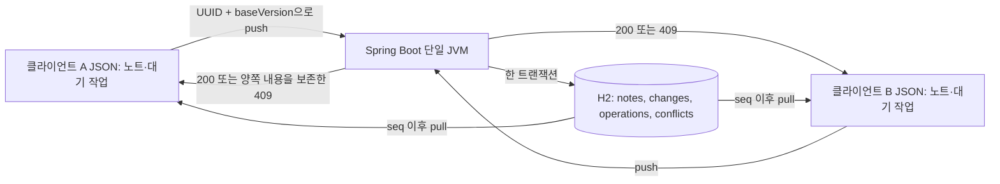

# 최소 동기화 엔진 설계

Java 21, Spring Boot 4.1.2, JDBC, H2 파일 DB와 Node.js CLI 클라이언트 두 개로 구성했다. 앱 UI, 첨부파일, 암호화, 계정, Joplin wire format은 범위 밖이다.



## 데이터와 일관성

| 저장소 | 역할 |
|---|---|
| `notes` | 논리 ID별 제목, 본문, 현재 version, deleted |
| `changes` | 증가하는 seq와 각 변경 시점의 전체 노트 스냅샷 |
| `operations` | opId, 정규화된 요청, 응답 상태·본문; 재요청의 결과를 고정 |
| `conflicts` | 작업 ID별 제안 내용과 충돌 당시 서버 내용 |
| 클라이언트 JSON | 현재 노트, pull cursor, pending, conflict 사본 |

최초 쓰기는 `baseVersion=0`, 서버 수락 후 version=1이다. 요청의 baseVersion과 현재 서버 version이 같으면 현재 노트를 갱신하고 버전을 1 증가시킨다. 다르면 409를 반환하고 제안 내용과 현재 내용을 서버 `conflicts`에 함께 남긴다. 서버의 정본은 변경하지 않는다.

노트 갱신, 변경 이력, 작업 결과 저장은 같은 JDBC 트랜잭션이다. 실패하면 모두 rollback한다. UUID가 같은 재요청은 이전 응답을 그대로 반환한다. 같은 UUID를 다른 payload에 쓰면 400이다. 클라이언트가 응답을 받기 전에 서버가 커밋한 경우에도 새 버전을 만들지 않는다.

`TransactionTemplate.execute` 전체를 단일 서비스 모니터 안에서 실행한다. commit까지 잠금을 유지해 변경 seq와 가시성이 뒤섞이지 않게 한다. pull도 같은 모니터를 사용한다. 이 동시성 계약은 **단일 JVM / 단일 DB writer**에 한정된다. DB의 identity 값이 일반적으로 commit 순서를 보장한다고 가정하지 않는다. 다중 서버 확장 시 DB 차원의 잠금과 커서 공개 프로토콜을 다시 설계해야 한다.

삭제는 본문을 유지한 `deleted=true` 버전이다. 자동 GC하지 않아 오래된 클라이언트도 삭제를 받는다. stale 편집과 삭제가 충돌하면 편집은 conflict에 보존한다. 현재 버전을 기준으로 명시적으로 재편집하면 복원할 수 있다. Joplin의 일반 삭제/영구 삭제 UI와는 다르다.

## 클라이언트와 재시도

`put`과 `delete`는 네트워크 없이 로컬 JSON에 저장한다. 아직 전송하지 않은 동일 노트의 연속 편집은 한 pending 작업으로 합친다. 전송하기 직전에 `attempted=true`를 저장하고 이후 그 payload와 UUID를 변경하지 않는다. 결과가 불명확한 작업이 있으면 해당 노트의 추가 편집을 막고 먼저 `sync`하도록 한다.

`sync`는 pending을 순서대로 push한 뒤 cursor 이후 변경을 pull한다. 409면 로컬 conflict 사본을 저장하고 서버 정본을 채택한다. 다른 상태의 4xx는 작업을 남기고 중단한다. 전송 오류·5xx에는 같은 UUID로 최대 3회, 100ms·200ms 간격으로 재시도한다. 각 HTTP 요청은 3초 timeout을 적용한다. 모두 실패하면 pending을 디스크에 남겨 다음 실행에서 재시도한다. 상시 백그라운드 재시도 프로세스는 없다.

응답 본문 파싱 실패도 전송 결과가 불명확하므로 동일 작업을 재시도한다. 파일 저장은 같은 디렉터리의 임시 파일을 만든 뒤 rename한다. OS 전원 손실에 대비한 fsync와 다중 프로세스 로컬 잠금은 구현하지 않았다. 동일 클라이언트 파일은 한 프로세스에서만 사용한다.

## HTTP API

| 메서드 / 경로 | 요청 / 결과 |
|---|---|
| `GET /health` | `{ "status": "UP" }` |
| `POST /sync/push` | 아래 Mutation. 성공 200, 충돌 409, 검증/UUID 재사용 오류 400 |
| `GET /sync/pull?after=0` | `{cursor, changes:[{seq,note}]}`; after는 0 이상 |
| `GET /conflicts?clientId=b` | 해당 클라이언트의 제안·충돌 당시 정본 |

```json
{
  "opId": "57be2ee4-f67a-45c1-84d4-23915dc1b5f5",
  "clientId": "a",
  "noteId": "note-1",
  "baseVersion": 0,
  "title": "첫 노트",
  "body": "본문",
  "deleted": false
}
```

노트 ID는 영문·숫자·밑줄·하이픈 1~100자, 제목 최대 1,000자, 본문 최대 100,000자다. UUID·필수 필드·baseVersion을 서버에서 검증한다. pull은 전체 해당 이력을 반환하며 페이지 크기 제한은 없다. 이력과 충돌의 무제한 증가, 인증 부재, 단일 writer 제약 때문에 로컬 실험용으로 사용한다.

## 검증

Java 통합 테스트 8개는 실제 H2·트랜잭션을 사용한다. 생성/수정/삭제 이력, stale 편집의 양쪽 내용 보존, 중복 성공/충돌 요청, UUID payload 불일치 거부, 삭제 후 stale 편집, 동시 쓰기의 단일 승자, cursor 증가를 검증한다.

`scripts/demo.mjs`는 실행 중인 HTTP 서버와 별도 로컬 클라이언트 파일을 사용한다. 실제 프록시가 서버에 요청을 전달하고 커밋 응답을 읽은 뒤 클라이언트 소켓을 파괴한다. 재시도가 전송됐고 서버 변경 기록은 1개, version은 1인 것을 확인한다. 닫힌 포트로의 실패 후 클라이언트를 새로 생성해 같은 pending UUID가 남는지도 검증한다.

H2 파일 DB는 원래 JVM을 종료하고 새 JVM으로 같은 파일을 연 뒤 전체 이력과 cursor를 비교했다. `evidence/persistence.json`에 결과를 보존했다.
